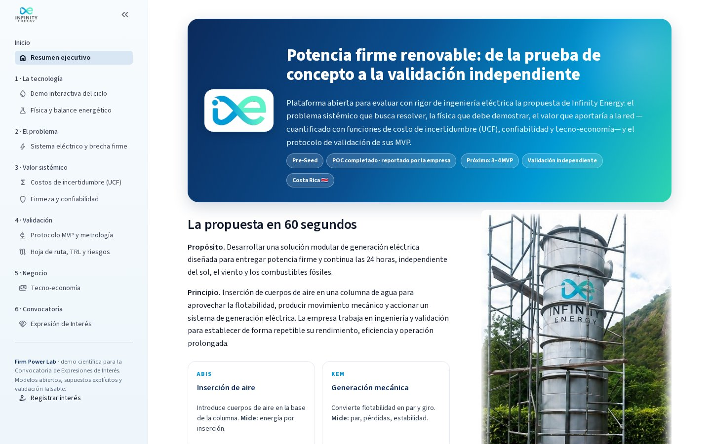
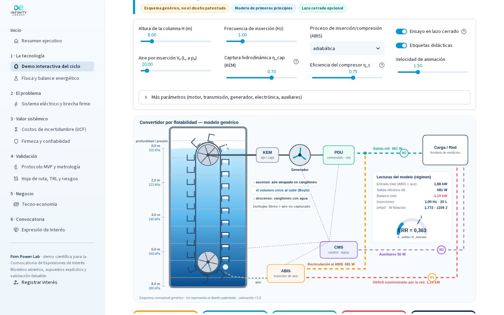
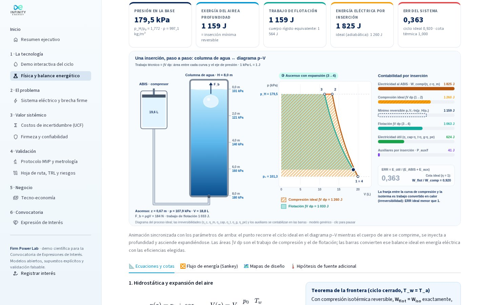
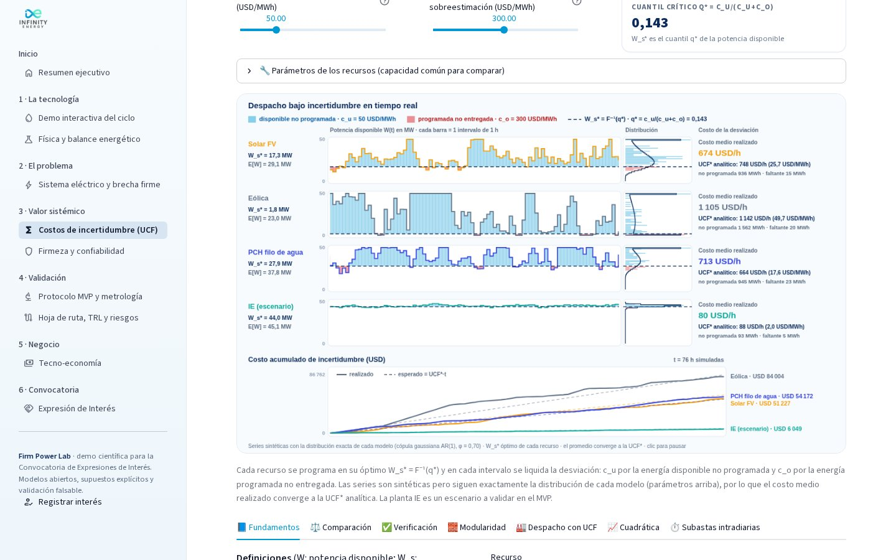

# Infinity Energy · Firm Power Lab

**Demo científica e interactiva para la Convocatoria de Expresiones de Interés de Infinity Energy.**
Evalúa, con rigor de ingeniería eléctrica, una propuesta de *generación renovable firme* basada en la inserción de
cuerpos de aire en una columna de agua: el problema sistémico que busca resolver (Costa Rica, 2026), la física que debe
demostrar, el valor que aportaría a la red —cuantificado con **funciones de costo de incertidumbre (UCF)**,
confiabilidad y tecno-economía— y el protocolo de validación de sus MVP.



> **Postura científica.** Los parámetros del módulo Infinity Energy son *supuestos de escenario*, no mediciones
> validadas. El resultado del POC es *reportado por la empresa* y no constituye validación independiente. El esquema
> físico es genérico y **no representa el diseño patentado**. La plataforma muestra explícitamente las cotas
> termodinámicas que el MVP debe superar o explicar, y convierte esa exigencia en un plan de validación falsable.

---

## Módulos

| Sección | Página | Qué contiene |
|---|---|---|
| Inicio | **Resumen ejecutivo** | Propuesta en 60 s (ABIS · KEM · PDU · CMS), postura científica, KPIs de contexto con fuentes y recorrido sugerido. |
| 1 · La tecnología | **Demo interactiva del ciclo** | Animación en canvas (modelo genérico) con balance en lazo cerrado; simulación electromecánica en el tiempo (arranque, rizado, sesgo por energía almacenada, punto de operación potencia–eficiencia). |
| | **Física y balance energético** | **Animación sincronizada columna ↔ diagrama p–V** (áreas ∫V dp de compresión y flotación en vivo, contabilidad eléctrica por inserción y ERR); hidrostática, compresión isotérmica/politrópica/adiabática, *teorema de la frontera* (ERR ≤ 1 en ciclo cerrado), **flujo de potencia animado** (Sankey de partículas) y Sankey interactivo, mapas de diseño e hipótesis de aporte térmico (límite de Carnot). |
| 2 · El problema | **Sistema eléctrico y brecha firme** | Despacho del SEN del 14-jun-2026 reconstruido por digitalización del gráfico DOCSE-ICE del video; escenario de nuevas cargas 24/7 (fertilizantes, semiconductores, centros de datos); brecha firme, costo térmico, CO₂ y módulos requeridos. |
| 3 · Valor sistémico | **Costos de incertidumbre (UCF)** | **Despacho bajo incertidumbre en tiempo real** (cada recurso programado en W_s*, liquidación c_u/c_o por intervalo, histogramas que convergen a la distribución teórica y costo medio que converge a la UCF*); UCF y MUCF para FV (log-normal), eólica (Weibull/Rayleigh), PCH filo de agua (Gumbel), VE/carga controlable (Normal), uniforme y planta modular firme (binomial–normal); verificación analítico vs integración numérica vs Monte Carlo; modularidad; despacho económico con UCF (KKT/λ); aproximación cuadrática; subastas intradiarias. |
| | **Firmeza y confiabilidad** | **Simulación animada de Markov**: N módulos vs una unidad del mismo tamaño frente al compromiso firme (cumplimiento, horas de déficit, ENS); COPT binomial, capacidad firme vs modularidad, ELCC por el método de Garver sobre el perfil real de Costa Rica, módulos necesarios para una carga 24/7. |
| 4 · Validación | **Protocolo MVP y metrología** | Frontera de balance, instrumentación y normas (IEC 62053-22, IEC 61869, IEC 61000-4-30, IEC 60034-2-1, ISO 1217, ISO/IEC 17025), presupuesto GUM, regla de decisión, simulador de campañas, errores metrológicos típicos, **análisis de CSV con informe descargable**, ensayo de autosostenimiento. |
| | **Hoja de ruta, TRL y riesgos** | TRL actual/objetivo, Gantt de 18 meses con gates cuantitativos, matriz de riesgos. |
| 5 · Negocio | **Tecno-economía** | LCOE + costo de incertidumbre vs referencias (IRENA 2025/2026, térmica de alquiler CR), CAPEX de equilibrio, dimensionamiento FV+BESS firme, tornado de sensibilidad. |
| 6 · Convocatoria | **Expresión de Interés** | Cuatro perfiles (ingeniería, tecnología/materiales, aliados estratégicos, inversión), mapa paquetes de trabajo × perfiles, preguntas de investigación y formulario (correo prellenado + JSON; webhook opcional). |





---

## Ejecutar localmente

```bash
python -m venv .venv
source .venv/bin/activate          # Windows: .venv\Scripts\activate
pip install -r requirements.txt
streamlit run app.py
```

Pruebas:

```bash
pip install pytest
pytest -q                          # 56 pruebas: modelos científicos y animaciones
python -m tests.smoke_app          # ejecuta todas las páginas sin navegador
```

## Publicar en GitHub

```bash
git init -b main                   # (si no usa el repositorio ya inicializado)
git add .
git commit -m "Firm Power Lab — demo científica EOI"
git remote add origin https://github.com/<usuario-u-organizacion>/infinity-energy-firm-power-lab.git
git push -u origin main
```

## Desplegar en Streamlit Community Cloud

1. Ingrese a <https://share.streamlit.io> con su cuenta de GitHub.
2. **Create app → Deploy a public app from GitHub**.
3. Repositorio: `<usuario>/infinity-energy-firm-power-lab` · Rama: `main` · Archivo principal: `app.py`.
4. *Advanced settings* → Python **3.12** (recomendado).
5. (Opcional) *Secrets*: para recibir las expresiones de interés en una hoja de cálculo o CRM, configure un webhook
   (Google Apps Script, Make, Zapier, Formspree…):

   ```toml
   EOI_WEBHOOK_URL = "https://..."
   ```
6. **Deploy**. La app queda en `https://<nombre>.streamlit.app`.

Si el repositorio es privado, Streamlit Community Cloud también puede desplegarlo concediendo acceso a la cuenta.

---

## Estructura

```
├── app.py                    # navegación (st.navigation) y tema
├── views/                    # páginas
├── core/
│   ├── physics.py            # ciclo termodinámico + dinámica electromecánica
│   ├── ucf.py                # UCF / MUCF analíticas, numéricas, Monte Carlo, despacho con UCF
│   ├── reliability.py        # COPT, capacidad firme, ELCC (Garver)
│   ├── metrology.py          # GUM, regla de decisión, campañas, análisis de CSV
│   ├── economics.py          # LCOE, FV+BESS firme, CAPEX de equilibrio
│   ├── anim.py               # animación del ciclo + infraestructura canvas común (HTML/JS autocontenido)
│   ├── anim_physics.py       # animaciones de Física: ciclo p–V y flujo de potencia
│   ├── anim_value.py         # animaciones de Valor sistémico: UCF en tiempo real y flota Markov
│   ├── data.py               # contexto, información pública y fuentes
│   ├── state.py · ui.py      # estado compartido, componentes y estilo
├── data/cr_despacho_2026-06-14_reconstruido.csv
├── docs/NOTA_TECNICA.md      # ecuaciones, supuestos y referencias
├── tests/                    # pytest + prueba de humo
└── .streamlit/config.toml    # tema de marca
```

## Personalización rápida

- **Datos de la empresa y fuentes:** `core/data.py` (`COMPANY`, `CR_FACTS`, `SOURCES`).
- **Despacho de referencia:** reemplace `data/cr_despacho_2026-06-14_reconstruido.csv` por datos oficiales del CENCE
  (mismas columnas).
- **Parámetros por defecto del modelo:** `core/physics.py` (`CycleParams`, `DynParams`).
- **Datos del MVP:** use la pestaña *Datos (CSV)* con la plantilla descargable; la UCF empírica puede calcularse con
  `core.ucf.EmpiricalResource`.

## Fuentes principales

ICE-DOCSE (Informes 2025, despacho del 14-jun-2026 mostrado en TV Legislativa), La Nación, Semanario Universidad,
CRHoy (térmica de alquiler 2027–2029), IRENA (*Renewable Power Generation Costs in 2024*; *24/7 renewables*, 2026),
Garver (1966), JCGM 100:2008 (GUM), Hunt et al. (2021, BEST). Ver `docs/NOTA_TECNICA.md`.

## Licencia y avisos

© 2026 Infinity Energy. Todos los derechos reservados (ver `LICENSE`). Infinity Energy, su logotipo e imágenes son
propiedad de la empresa. Las solicitudes de patente (CR 2024-0000354 · PCT/CR2025/050003 · IN 202617045117) no
equivalen a patentes concedidas. Contacto: **info@infinityen.energy** · <https://www.infinityen.energy>
